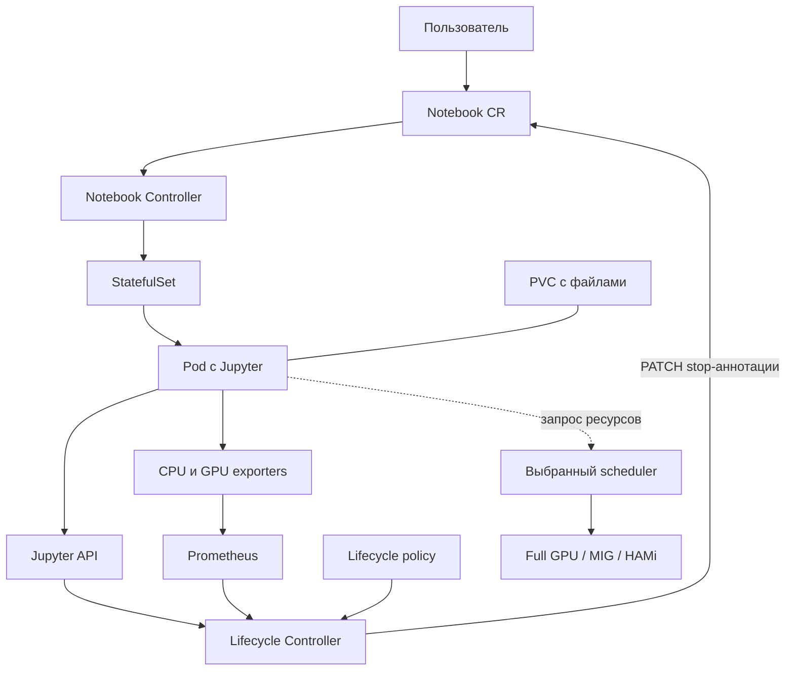
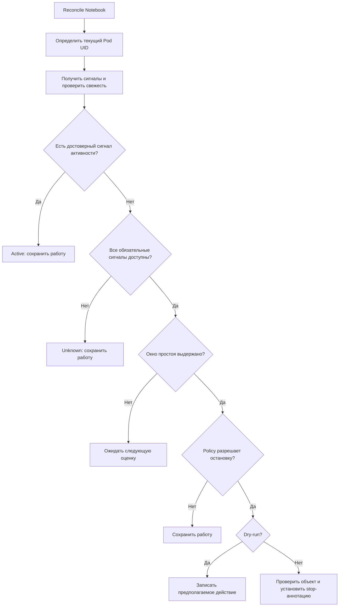

# Lifecycle Controller для Kubeflow Notebook

Проект ВКР по управлению жизненным циклом интерактивных ML-окружений и распределению GPU-ресурсов в Kubernetes/Kubeflow.

## Статус

На 15 октября 2026 года подготовлены план и презентация ВКР. Реализация контроллера и экспериментальные результаты ещё не представлены. Команды установки и запуска появятся после создания прототипа.

## Цель

Сократить резервирование ресурсов простаивающими Notebook и экспериментально оценить Full GPU, MIG, HAMi/vGPU и очереди Volcano.

## Репозиторий и сопровождение

Целевое размещение — «Сфера Код». Действующая ссылка пока не предоставлена. После создания репозитория добавьте его URL в этот раздел и презентацию. Обсуждения, задачи, правки и проверки ведутся в «Сфера Код».

## Планируемая архитектура

Lifecycle Controller получает активность Jupyter и метрики CPU/GPU из Prometheus, вычисляет Active, Idle или Unknown и применяет политику остановки. Он изменяет штатную stop-аннотацию Notebook. Существующий Notebook Controller управляет StatefulSet и освобождает вычислительные ресурсы. Пользовательские файлы сохраняются на PVC. Память процессов и состояние GPU при остановке не сохраняются.

Следующие схемы и интерфейсы описывают будущую реализацию. Точный contract stop/resume нужно подтвердить для установленной версии Kubeflow.



Стрелки от источников обозначают поток данных. Контроллер будет опрашивать Jupyter и Prometheus. История временных рядов остаётся в Prometheus, а в Kubernetes сохраняется только компактное состояние решения.

### Ответственность компонентов

| Компонент | Роль |
| --- | --- |
| Notebook Controller | Создание ресурсов Notebook и выполнение штатной остановки |
| Lifecycle Controller | Получение сигналов, оценка активности и применение policy |
| Jupyter API | Активность kernels, sessions и terminals в поддерживаемой версии |
| Prometheus | История CPU/GPU-метрик и запросы по временному окну |
| DCGM / HAMi metrics | GPU-телеметрия с доступной для выбранного режима детализацией |
| GPU allocation layer | Выделение целой GPU, MIG instance или программной доли |
| Volcano, если выбран | Очереди, приоритеты и fairness |

Прямое удаление Pod не подходит: StatefulSet с ненулевым числом реплик создаст его заново. Lifecycle Controller будет изменять желаемое состояние Notebook через штатную stop-аннотацию. Её точный ключ и формат определяются на этапе аудита.

HAMi standalone и Volcano vGPU рассматриваются как отдельные конфигурации эксперимента. Установка нескольких device plugins, претендующих на один ресурс одной ноды, не предполагается. Итоговый GPU-режим выбирается после проверки оборудования и версий.

## Модель активности и принятие решения



| Состояние | Условие | Действие |
| --- | --- | --- |
| `Active` | Есть достоверное подтверждение активности | Оставить Notebook запущенным, сбросить idleSince |
| `Idle` | Все обязательные источники доступны и подтверждают непрерывный простой | Проверить timeout и ограничения policy |
| `Unknown` | Нет подтверждения активности и не хватает достоверных данных | Оставить Notebook запущенным |

Положительный сигнал активности запрещает остановку даже при ошибке другого источника. Ошибки источников при этом остаются в диагностике. Отсутствие метрики не считается нулевой нагрузкой.

`IdleCandidate`, `Excluded` и `Stopped` могут использоваться как внутренние состояния lifecycle или причины решения. Они не подменяют основные состояния активности.

### Источники сигналов

- Jupyter: время последней активности и состояние вычислений через API поддерживаемой версии.
- CPU: использование за временное окно с явно выбранной нормализацией.
- GPU: активность конкретного workload, если атрибуция подтверждена.
- VRAM: дополнительный признак удерживаемого ресурса. Занятая память сама по себе не доказывает полезные вычисления.
- Качество данных: возраст выборок, ошибки запросов и связь Notebook–Pod–GPU.

Нагрузка физической GPU не должна автоматически приписываться каждому Notebook на ней. Если режим sharing не позволяет надёжно определить активность отдельного workload, GPU-aware остановка остаётся выключенной для таких окружений либо использует согласованную консервативную policy.

## Планируемая реализация контроллера

Контроллер будет отдельным Go-процессом в Kubernetes. Для MVP достаточно внутренних моделей и конфигурации. Отдельные CRD `Activity` и `Lifecycle` пока не требуются.

| Модуль | Ответственность |
| --- | --- |
| `NotebookResolver` | Поиск текущего Pod, UID, контейнеров и GPU allocation |
| `ActivitySource` | Получение сигнала, его времени и результата запроса |
| `ActivityEvaluator` | Объединение сигналов в Active / Idle / Unknown |
| `LifecyclePolicy` | Timeout, grace period, minimum runtime и exclusions |
| `LifecycleReconciler` | Повторные оценки и идемпотентный PATCH Notebook |
| `Observability` | Метрики, события и причины решений |

Порядок разработки:

1. Реализовать evaluator и policy как функции с управляемыми часами.
2. Добавить fake-источники и сценарии ошибок.
3. Подключить Jupyter и Prometheus с timeout и ограничением параллелизма.
4. Реализовать reconcile в dry-run без изменения Notebook.
5. Добавить stop action, обработку конфликтов и подтверждение освобождения ресурсов.
6. Включить действия на тестовом пуле после safety-проверок.

При restart контроллера или смене Pod UID планируется консервативно сбрасывать неподтверждённое окно простоя. Перед PATCH необходимо повторно проверить объект, keep-alive и актуальную policy. Повторный reconcile не должен приводить к повторному или конфликтующему действию.

### Предлагаемая структура репозитория

Это план структуры, а не перечень уже реализованных файлов:

```text
.
├── README.md
├── go.mod
├── cmd/controller/main.go
├── internal/
│   ├── controller/      # Reconcile и stop action
│   ├── activity/        # Сигналы и evaluator
│   ├── sources/         # Jupyter и Prometheus adapters
│   ├── policy/          # Правила остановки
│   ├── resolver/        # Notebook–Pod–GPU mapping
│   └── observability/   # Метрики и события
├── config/              # Deployment, RBAC, конфигурация
├── tests/               # Integration и E2E
├── experiments/         # Нагрузки и анализ результатов
└── docs/                # Аудит, решения и эксплуатация
```

### Конфигурация policy

Иллюстративный формат, **ещё не реализованный API**:

```yaml
mode: dry-run
policy:
  idleTimeout: 30m
  startupGracePeriod: 10m
  minimumRuntime: 15m
  maxSignalAge: 2m
  onUnknown: keep-running
  signals:
    jupyter:
      required: true
    cpu:
      required: true
    gpu:
      requiredWhenRequested: true
  exclusions:
    annotation: lifecycle.example.org/never-cull
```

Значения служат отправной точкой исследования. Thresholds, интервалы опроса и нормализация будут выбраны после baseline. Право устанавливать исключение из auto-stop должно определяться административной policy.

### Остановка и повторный запуск

Успешный PATCH ещё не доказывает освобождение GPU. Оно подтверждается завершением Pod и обновлением allocation. Файлы сохраняются на корректно настроенном PVC. Память процессов, состояние kernel и GPU-контекст при остановке теряются.

Повторный запуск в MVP выполняется штатным способом Kubeflow. Wake-on-request и checkpointing в первую версию не входят.

Для Notebook, управляемых новым контроллером, требуется единственный владелец решения об auto-stop. Перед включением mutation нужно отключить или исключить для них штатный culling. Иначе он сможет остановить окружение независимо от нового evaluator.

## Технологии

- Go и controller-runtime для контроллера.
- Kubernetes и Kubeflow Notebook для окружений.
- Prometheus, Jupyter API, NVIDIA DCGM или HAMi metrics для телеметрии.
- NVIDIA GPU stack, MIG, HAMi и Volcano для экспериментальных конфигураций.

Версии компонентов и поддержка MIG зависят от стенда и будут зафиксированы после аудита.

## Политики безопасности

- При ошибке или устаревании обязательной телеметрии сохранять Notebook запущенным.
- Учитывать время после старта, минимальное время работы и непрерывное окно простоя.
- Поддерживать исключение из автоматической остановки.
- Начать с dry-run и включить остановку после проверки контрольных сценариев.
- Использовать минимальные права RBAC и не хранить секреты в репозитории.

## Установка и запуск

Исполняемый компонент пока не реализован. Первым шагом требуется собрать версии кластера, характеристики GPU, доступные метрики и связи Notebook–Pod–GPU. После реализации здесь будут точные команды сборки, установки, настройки и удаления контроллера, а также способ отключения автоматических действий.

Необходимо зафиксировать версии Kubernetes и Kubeflow, commit Notebook Controller, модель GPU, драйвер, runtime, владельца device-plugin ресурсов, Prometheus targets, labels и доступ к Jupyter API. Развёртывание планируется в отдельном namespace и на выделенном GPU-пуле.

Контроллеру нужны права чтения связанных ресурсов и ограниченные права PATCH Notebook. Изменение MIG geometry, удаление PVC и произвольный exec в пользовательский Pod в его обязанности не входят. Credentials передаются через Secrets и не попадают в логи.

Планируемая наблюдаемость: число оценок по состоянию, действия по результату, ошибки источников, возраст данных и длительность reconcile. Метрики должны иметь ограниченную кардинальность, подробности по Notebook доступны в логах и Events.

Отключение автоматических действий должно быть доступно одной настройкой. Переключение в dry-run не запускает ранее остановленные Notebook: их возобновляют штатным механизмом.

## План проверок

Модульные тесты модели активности и policy, интеграционные проверки reconcile, сценарии ошибок Jupyter/Prometheus, E2E остановка и повторный запуск Notebook с PVC. Контрольные случаи Active и Unknown не должны приводить к автоматической остановке.

Критерий первого включения: **0 ложных остановок на контрольном наборе Active/Unknown-сценариев**. Это характеристика тестового набора, а не гарантия для произвольных нагрузок. Дополнительно проверяются stale samples, restart контроллера, смена Pod UID, конфликты PATCH и идемпотентность.

## Эксперименты

Сравнить базовый culling и новый контроллер. На доступном оборудовании сравнить Full GPU, MIG и HAMi/Volcano vGPU. Нагрузки: интерактивная работа, длительное обучение, простой и конкуренция пользователей. Фиксировать конфигурации, версии, образы, входные данные и повторные запуски.

Метрики: ложные остановки, задержка обнаружения, GPU utilisation, VRAM, throughput, slowdown, время ожидания p95 и fairness. Данные ещё не собраны, количественные эффекты не подтверждены.

Baseline, эффект lifecycle, GPU sharing и scheduling оцениваются по отдельности. Ground truth активности задаётся тестовыми сценариями независимо от evaluator. Для запуска фиксируются commit, версии, image digests, конфигурация, входные данные и временные границы. Нужны повторные измерения и сохранённые выгрузки метрик.

## Этапы и критерии готовности

| Этап | Результат |
| --- | --- |
| Аудит | Стенд и проверенный Notebook stop/resume contract |
| Baseline | Сценарии, исходные метрики и ground truth |
| Наблюдение | Достоверная корреляция Notebook–Pod–GPU |
| Dry-run | Состояния и причины решений без остановок |
| MVP | Проверенный stop/resume и safety-сценарии |
| GPU / Volcano | Сравнение доступных режимов и политик |
| Сопровождение | README с рабочими командами, тесты и ограничения |

## Открытые вопросы

- Какая версия Notebook Controller работает на стенде?
- Поддерживают ли доступные GPU MIG?
- Есть ли надёжная per-workload GPU telemetry при sharing?
- Кто может запрещать auto-stop и как долго действует keep-alive?
- Какие политики queues соответствуют пользователям платформы?

Ранее обсуждавшиеся дефекты `last-activity` и culling-метрик нужно подтвердить на точном commit. Они не считаются доказанными для текущего стенда.

## Ближайшие задачи

1. Создать репозиторий в «Сфера Код», добавить README и URL.
2. Зафиксировать конфигурацию стенда и baseline.
3. Реализовать источники активности и dry-run контроллера.
4. Проверить безопасный stop/resume.
5. Провести GPU и scheduling эксперименты.

## Границы работы

Основной результат — Lifecycle Controller и экспериментальная оценка. Полное обновление Kubeflow, разработка портала и KubeVirt не входят в обязательную часть.
