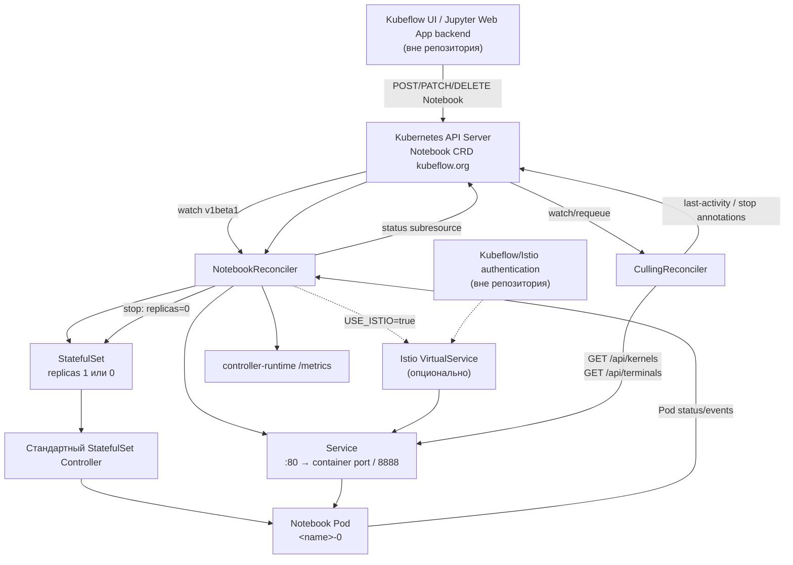

****# Техническое резюме архитектуры Notebook Controller

## Главный вывод

Локальный репозиторий — не весь Kubeflow, а отдельный компонент `Notebook Controller`: Kubernetes-оператор, управляющий CRD `Notebook`.

Frontend, Jupyter Web App backend, Profiles, Dex/OIDC, PodDefault webhook, GPU Operator и Prometheus deployment здесь отсутствуют. Поэтому карта ниже описывает фактическую архитектуру этого контроллера и отмечает внешние границы Kubeflow.

Точная версия неизвестна: каталога `.git` нет. `go.mod` указывает на исторический путь `github.com/kubeflow/kubeflow/components/notebook-controller`, Go 1.17, Kubernetes libraries 0.23 и controller-runtime 0.11.

## Краткая архитектурная схема



Важно: непосредственно Pod создаёт стандартный Kubernetes StatefulSet-controller. Notebook Controller создаёт и сопровождает `StatefulSet`, `Service` и, опционально, `VirtualService`.

## Структура репозитория

| Путь | Назначение |
|---|---|
| `api/` | Go-типы CRD `Notebook` версий `v1`, `v1alpha1`, `v1beta1`, deepcopy-код и заготовка conversion webhook. |
| `controllers/` | Основная reconcile-логика и idle-culling, unit/integration tests. |
| `pkg/metrics/` | Пользовательские Prometheus-метрики контроллера. |
| `manifests/` | CRD, Deployment, ConfigMap, RBAC, Service и пример `Notebook`. Helm/Kustomize overlays отсутствуют. |
| `common/` | Локальная копия reconcile helpers как отдельный Go module. Однако root-модуль фактически зависит от удалённой версии `components/common`; `replace`/`go.work` нет. |
| `hack/` | Boilerplate и dev-only Istio `AuthorizationPolicy` для culling. |
| `third_party/` | Лицензии и служебная информация о зависимостях. |
| `main.go` | Запуск controller-runtime manager, регистрация reconciler’ов, metrics и health endpoints. |
| `Dockerfile` | Сборка бинарника `/manager` и distroless runtime image. |
| `.gitlab-ci.yml` | GitLab CI: formatting, LSIF, build/push/release контейнера. |

## Ключевые компоненты

| Область | Что реализовано |
|---|---|
| Frontend | Отсутствует. Комментарий в reconciler упоминает внешний `jupyter-web-app`, который создаёт и удаляет CR. |
| Backend/API | Отдельного REST-backend нет. API проекта — стандартный Kubernetes API для `Notebook` CRD. |
| CRD | Namespaced-ресурс `notebooks.kubeflow.org`; обслуживаются `v1`, `v1alpha1`, `v1beta1`, storage version — `v1`. |
| Оператор | controller-runtime manager с `NotebookReconciler` и опциональным `CullingReconciler`. |
| Workload | Один `StatefulSet` с одной репликой; остановка реализована как scale-to-zero. |
| Сеть | `ClusterIP Service`; при `USE_ISTIO=true` — `VirtualService` с маршрутом `/notebook/{namespace}/{name}/`. |
| Kubeflow-интеграция | Notebook CRD, Kubeflow notebook image, копирование labels для внешнего PodDefault webhook, optional Istio gateway. |
| Мониторинг | `/metrics` controller-runtime и несколько собственных metrics, но culling-метрики сейчас неправильно подключены. ServiceMonitor/PodMonitor отсутствуют. |
| Аутентификация | Только in-cluster ServiceAccount/RBAC контроллера. Пользовательская Kubeflow/Dex/OIDC authentication находится снаружи. |
| CPU/RAM/GPU | Передаются прозрачно как часть `corev1.PodSpec`; GPU-specific логики нет. |
| Notebook/Workspace | Реализован singleton Notebook server. Отдельной сущности `Workspace` и lifecycle для группы ресурсов нет. |

## CRD и контракт окружения

Главный API-тип — `NotebookSpec` в `api/v1/notebook_types.go`:

```text
Notebook
└── spec.template.spec: corev1.PodSpec
```

Это означает, что CR может содержать стандартные Kubernetes-поля:

- containers, images, commands и environment;
- CPU/RAM requests и limits;
- GPU/другие extended resources;
- volumes и PVC references;
- affinity, nodeSelector, tolerations;
- runtimeClassName, priorityClassName, serviceAccountName;
- securityContext и initContainers.

CRD сгенерирован в `manifests/kubeflow.org_notebooks.yaml`. `v1` является storage version, а `v1alpha1` и `v1beta1` продолжают обслуживаться.

Контроллер при этом работает с Go-типом `v1beta1`. Conversion webhook существует только как заготовка и отключён в `main.go`. Поскольку схемы версий сейчас практически одинаковы, это работает без специального conversion endpoint, но эволюция API потребует отдельного внимания.

## Основной runtime flow

### 1. Создание

Внешний UI/backend выполняет стандартный запрос:

```text
POST /apis/kubeflow.org/v1/namespaces/{namespace}/notebooks
```

В этом репозитории кода клиента нет.

`NotebookReconciler.Reconcile` получает событие CR в `controllers/notebook_controller.go` и создаёт:

1. `StatefulSet` с тем же именем;
2. `Service` с тем же именем;
3. `VirtualService`, если включён Istio.

Всем дочерним объектам устанавливается owner reference на `Notebook`.

### 2. Формирование StatefulSet и Pod

`generateStatefulSet`:

- копирует `Notebook.spec.template.spec` в `StatefulSet.spec.template.spec`;
- устанавливает одну реплику;
- при annotation `kubeflow-resource-stopped` устанавливает ноль реплик;
- добавляет labels `statefulset` и `notebook-name`;
- копирует labels самого Notebook в Pod template;
- первому контейнеру задаёт default working directory `/home/jovyan`;
- добавляет порт `8888`, если порты не заданы;
- добавляет `NB_PREFIX=/notebook/{namespace}/{name}`;
- по умолчанию добавляет `fsGroup: 100`.

Затем встроенный StatefulSet-controller создаёт Pod `<notebook-name>-0`.

### 3. Сеть

`generateService` создаёт `ClusterIP Service`:

```text
Service :80 → первый порт первого контейнера или :8888
```

`generateVirtualService` добавляет Istio route:

```text
/notebook/{namespace}/{name}/ → {name}.{namespace}.svc.{cluster-domain}:80
```

Annotations `http-rewrite-uri` и `http-headers-request-set` позволяют модифицировать rewrite и request headers.

### 4. Состояние

Контроллер следит за CR, дочерними StatefulSet/Service/VirtualService, labeled Pods и Kubernetes Events в `SetupWithManager`.

`createNotebookStatus` заполняет:

- `readyReplicas` из StatefulSet;
- `conditions` из Pod conditions;
- `containerState` из контейнера, имя которого совпадает с именем `Notebook`.

Последний пункт создаёт важный инвариант: основной контейнер должен называться так же, как CR.

### 5. Изменение

При обновлении PodSpec контроллер обновляет шаблон StatefulSet, после чего стандартный StatefulSet-controller выполняет замену Pod.

Специальной логики in-place resize, checkpointing или миграции нет.

### 6. Остановка и возобновление

`CullingReconciler`:

1. опрашивает Jupyter endpoints `/api/kernels` и `/api/terminals`;
2. сохраняет timestamps в annotations;
3. при превышении `CULL_IDLE_TIME` добавляет `kubeflow-resource-stopped`;
4. основной reconciler видит annotation и ставит `replicas=0`.

Возобновление выполняется внешним клиентом посредством удаления stop annotation. Тогда replicas возвращается к `1`.

### 7. Удаление

При `DeletionTimestamp` основной reconciler ничего не создаёт и не обновляет.

Собственной finalizer/delete-логики нет. StatefulSet, Service и VirtualService должны удаляться Kubernetes garbage collector по owner references. Политика foreground deletion задаётся внешним UI/backend.

## Карта кода по операциям

| Операция | Основные точки |
|---|---|
| Создание окружения | `NotebookReconciler.Reconcile`; `generateStatefulSet`; `generateService`; `generateVirtualService` |
| Обновление окружения | `Reconcile`; фактически используемый remote `reconcilehelper.CopyStatefulSetFields` |
| Удаление | Проверка `DeletionTimestamp`; owner references; Kubernetes GC |
| Stop/resume | `STOP_ANNOTATION`; `setStopAnnotation`; `StopAnnotationIsSet`; `generateStatefulSet` |
| Status | `updateNotebookStatus`; `createNotebookStatus`; `PodCondToNotebookCond` |
| CPU/RAM/GPU | `NotebookTemplateSpec.Spec corev1.PodSpec`; passthrough в `generateStatefulSet` |
| Labels | `generateStatefulSet`; `predNBPodIsLabeled`; `mapPodToRequest` |
| Annotations | Constants в обоих controllers; VirtualService routing; culling timestamps |
| Kubernetes events | `predNBEvents`; `nbNameFromInvolvedObject`; повторная публикация Events на CR |
| Frontend → Kubernetes | В репозитории отсутствует; внешний клиент должен создавать/patch/delete `Notebook` |
| Jupyter API | `getNotebookApiKernels`; `getNotebookApiTerminals` |
| Metrics | `pkg/metrics/metrics.go`; регистрация в `main.go` |

## Потенциальные точки расширения

| Будущая задача | Текущая точка расширения | Что изучать/менять |
|---|---|---|
| Метрики активности | Jupyter API polling уже реализован | `getNotebookApiKernels`, `getNotebookApiTerminals`, `updateNotebookLastActivityAnnotation`, `pkg/metrics/metrics.go`, wiring в `main.go` |
| Новый idle detector | `CullingReconciler` и activity annotations | `CullingReconciler.Reconcile`, `notebookIsIdle`, `allKernelsAreIdle`, `updateTimestampFromLastActivity`; желательно отделить activity source от policy |
| Автоматическая остановка | Annotation → replicas=0 уже работает | `setStopAnnotation`, `generateStatefulSet`; добавить policy per Notebook, explicit status condition, event/reason, retry semantics |
| Управление GPU | GPU request уже проходит в PodSpec | API types, CRD `containers[].resources`, `generateStatefulSet`; внешне — device plugin/GPU Operator/DCGM/scheduler/quota |
| GPU usage/idle | Не реализовано | Новый metrics collector либо внешний Prometheus/DCGM источник; сопоставление GPU process ↔ Pod/Notebook |
| Новые extended resources | Kubernetes `ResourceList` уже принимает произвольные resource names | Для простого ресурса часто достаточно frontend и cluster device plugin; controller менять не требуется |
| Новая семантическая модель ресурсов | Отдельных CPU/GPU profiles нет | Добавить поля CRD, validation/defaulting webhook, преобразование в PodSpec, status и API versioning |
| Другие server types | Culling жёстко предполагает Jupyter API | Ввести adapter по server type или отдельные detectors/controllers; annotation `server-type` из примера сейчас не используется |
| Полноценный Workspace | Контроллер управляет одним StatefulSet | Новый CRD/controller или расширение модели ownership для PVC, сервисов, jobs и вспомогательных ресурсов |
| Улучшенный status | Сейчас зеркалируется только Pod/StatefulSet | Расширить `NotebookStatus`: idle/stopped, resource allocation, node/GPU, last activity, failure reason |
| Authentication-aware culling | GET выполняется без credentials | HTTP client в culling controller, Istio AuthorizationPolicy, service-account identity/token propagation |
| Admission/validation | Webhook практически пуст и отключён | `api/v1beta1/notebook_webhook.go`, `main.go`, webhook manifests и CRD conversion strategy |

## Подтверждённые архитектурные риски

Независимая read-only проверка подтвердила следующие проблемы.

1. **Idle-culling содержит логическую ошибку.** В `updateTimestampFromLastActivity` `recentTime` начинается с `time.Now()`, после чего принимаются только timestamps позже текущего времени. Обычная прошлая активность не заменяет значение, и annotation снова становится близкой к `now`. При непустом списке idle kernels/terminals Notebook практически не достигнет idle threshold.

2. **Culling-метрики не подключены:**

   - `CullingReconciler` создаётся без `Metrics` в `main.go`;
   - `setStopAnnotation` поэтому не увеличивает counters;
   - `Describe`/`Collect` не экспортируют culling vectors.

3. **`notebook_running` считает StatefulSet даже при `replicas=0`**, то есть stopped Notebook считается running. Исчезнувшие namespace series также не обнуляются.

4. **Controller metrics слушают `:8080`, но `manifests/service.yaml` публикует `443` без `targetPort`.** Назначение этого Service неясно; готового metrics Service/ServiceMonitor нет.

5. **Локальный `common/reconcilehelper` не является фактически используемым runtime-кодом.** Импорт разрешается в pinned remote module из `go.mod`.

6. **Произвольные Notebook labels могут перезаписать служебные `statefulset` и `notebook-name`**, нарушив selector, Service routing и Pod event mapping.

7. **Первый контейнер используется без проверки как основной.** Пустой `containers` или пустой `ports` slice могут вызвать panic; sidecar на первом месте получит `NB_PREFIX` и определит Service port.

8. **`setPrefixEnvVar` изменяет копию элемента range**, поэтому уже существующий неверный `NB_PREFIX` фактически не обновляется.

9. **`IDLENESS_CHECK_PERIOD` и `ISTIO_CLUSTER_DOMAIN` присутствуют в ConfigMap, но не передаются в Deployment.**

## Что пока неизвестно

Для полной архитектуры Kubeflow потребуется дополнительно исследовать:

- версию и код Jupyter Web App/frontend, формирующего `Notebook` CR;
- механизм stop/start/delete в frontend backend;
- Kubeflow Profiles и создание пользовательских namespaces;
- PodDefault admission webhook и инъекции в Notebook Pod;
- реальные deployment overlays, Helm/Kustomize manifests и соответствие образа `aispaceru/nb-c:latest` исходникам;
- Dex/OIDC, AuthService, Istio gateway и production AuthorizationPolicy;
- ResourceQuota/LimitRange и ограничения CPU/RAM/GPU;
- NVIDIA/AMD device plugin, GPU Operator, MIG/time-slicing и DCGM exporter;
- PVC provisioning и ownership: контроллер сам PVC не создаёт;
- Prometheus scrape configuration;
- поддерживаемые notebook images и необходимость token/auth для `/api/kernels` и `/api/terminals`;
- фактическую conversion strategy между тремя API versions;
- runtime-поведение в реальном Kubernetes-кластере.

## Приоритетный список для дальнейшего изучения

1. `controllers/notebook_controller.go` — основной lifecycle и генерация ресурсов.
2. `controllers/culling_controller.go` — activity, idle и stop policy.
3. `api/v1/notebook_types.go` — текущий API-контракт.
4. `manifests/kubeflow.org_notebooks.yaml` — реальная опубликованная схема CRD.
5. `pkg/metrics/metrics.go` — monitoring extension point.
6. `main.go` — wiring controllers, metrics, probes и leader election.
7. `manifests/configmap.yaml`, `deployment.yaml`, `role.yaml` — runtime configuration и permissions.
8. `controllers/notebook_controller_test.go` и `culling_controller_test.go` — существующие invariants.
9. `controllers/suite_test.go` — envtest setup, сейчас ссылающийся на отсутствующий `config/crd/bases`.
10. Внешний Jupyter Web App/frontend — следующий обязательный репозиторий для трассировки полного пути `UI → Kubernetes`.

## Проверка

- Код и manifests проанализированы без изменений исходного кода.
- `gofmt -d` не показал отклонений.
- Изолированные unit-тесты status/culling прошли.
- Полный `go test ./...` не завершён: отсутствуют envtest-бинарники `/usr/local/kubebuilder/bin/etcd`; кроме того, test setup ожидает отсутствующий каталог `config/crd/bases`.
- Работа в реальном Kubernetes-кластере не проверялась.
